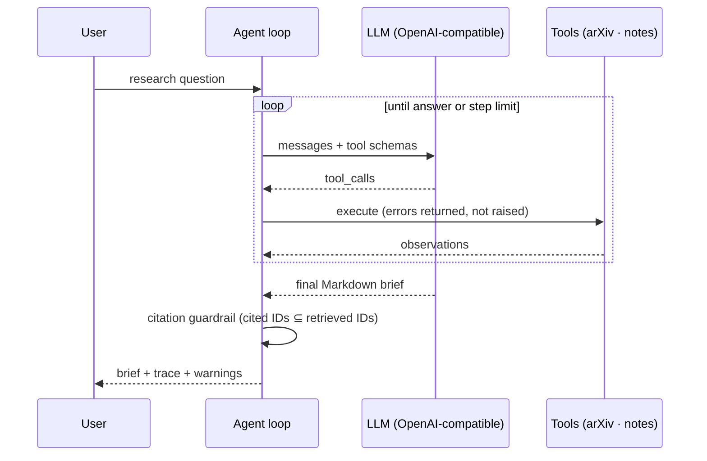

<h1 align="center">🤖 Agentic Research Assistant</h1>

<p align="center">
  <b>An autonomous tool-calling agent that searches arXiv, reads abstracts, takes notes and writes a cited literature brief, with a built-in guardrail against hallucinated citations.</b>
</p>

<p align="center">
  
  
  
  
  
  <a href="https://github.com/amanatarslan270-cyber/agentic-research-assistant/actions"></a>
</p>

---

## Highlights

- **Agent loop from scratch.** A ReAct-style loop of plan → call tool → observe → repeat, built directly on the Chat Completions tool-calling API with no LangChain dependency. It's easy to read, debug and extend.
- **Model-agnostic.** Works with any OpenAI-compatible endpoint: OpenAI, Groq (free tier), OpenRouter, or a **local Ollama model** with no API cost.
- **Real tools.** `search_arxiv`, `get_paper` and `save_note` call the live arXiv API.
- **Hallucination guardrail.** Every `[arXiv:ID]` in the final answer is checked against the papers the agent actually retrieved. Any ID it never saw is flagged.
- **Robust.** Tool errors go back to the model instead of crashing the run, there is a step budget with forced summarisation, and the tests run offline.

## Architecture



## Quick start

```bash
git clone https://github.com/amanatarslan270-cyber/agentic-research-assistant.git
cd agentic-research-assistant
pip install -e .

cp .env.example .env      # choose OpenAI, Groq or Ollama, then:
export $(grep -v '^#' .env | xargs)

research-agent "What are the main approaches to detecting AI-generated text, and where do they fail?" --out brief.md
```

The agent prints each tool call as it works (`🔧 step 1: search_arxiv({...})`), then the final brief with `## Overview`, `## Key papers` and `## Open problems`, followed by a run summary.

### Python API

```python
from research_agent import ResearchAgent, LLMClient

agent = ResearchAgent(llm=LLMClient(model="llama-3.3-70b-versatile"), max_steps=10, verbose=True)
result = agent.run("Survey retrieval-augmented generation for small language models")
print(result.answer)
print(result.tool_calls)             # full trace
print(result.unverified_citations)   # should be []
```

## Extending

Adding a tool takes three steps: write a method on `Toolbox`, register it in `Toolbox.call`, and add its JSON schema to `TOOL_SCHEMAS`. Ideas: Semantic Scholar citations, PDF full-text reading, a vector store for long-term memory, or Crossref verification (see my [citation-hallucination-checker](https://github.com/amanatarslan270-cyber/citation-hallucination-checker)).

## Tests

```bash
pip install -e ".[dev]" && pytest -q
```

The tests use a scripted fake LLM and a canned arXiv feed, so no network or API key is needed.

## Roadmap

- [ ] Streamlit / Gradio UI
- [ ] Multi-agent mode (searcher, critic, writer)
- [ ] Semantic Scholar and PDF tools
- [ ] Evaluation harness: citation precision and coverage vs. human reviews

## Author

**Muhammad Arslan**, Agentic AI Engineer and NLP Researcher, University of Sahiwal
[LinkedIn](https://www.linkedin.com/in/arslan-amanat-393186380) · [GitHub](https://github.com/amanatarslan270-cyber)

## License

MIT
